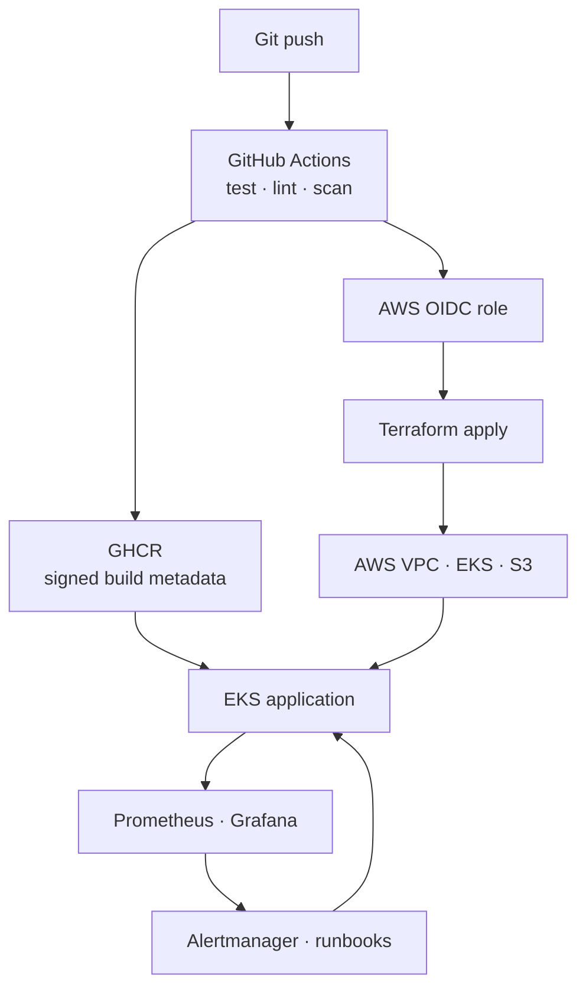

# Production Platform Simulation

An end-to-end DevOps reference implementation that provisions a production-like
AWS platform entirely through code, builds and scans a containerized service,
deploys it to Amazon EKS, and verifies failure detection through
Prometheus/Grafana/Alertmanager.

> This project creates billable AWS resources, including EKS worker nodes, a NAT
> gateway, EBS volumes, CloudWatch logs, KMS keys, and S3 storage. Deploy it in an
> isolated sandbox account and destroy it when finished.

## What this demonstrates

- **Modular Terraform:** VPC, public/private subnets, NAT, flow logs, EKS,
  managed node groups, EBS CSI through Pod Identity, encrypted/versioned S3,
  KMS, remote state, and GitHub OIDC.
- **CI/CD:** Go tests and vetting, Terraform validation, Helm linting, TFLint,
  Checkov, Gitleaks, Docker build, Trivy image scanning, SBOM/provenance, GHCR
  publishing, and Terraform deployment.
- **Reliability:** three replicas, rolling updates, topology spreading,
  readiness/liveness/startup probes, HPA, PDB, and restricted pod privileges.
- **Observability:** Prometheus, Grafana, Alertmanager, application metrics,
  ServiceMonitor, three alerts, webhook notifications, and runbooks.
- **Failure simulation:** repeatable error-rate, availability, and restart
  scenarios with an explicit recovery path.

## Architecture



See [docs/ARCHITECTURE.md](docs/ARCHITECTURE.md) for the resource and request
flows.

## Repository layout

```text
.
├── cmd/api/                         # Go service and unit tests
├── deploy/chart/                    # Hardened application Helm chart
├── docs/                            # Architecture, trade-offs, and runbooks
├── scripts/                         # Bootstrap, deploy, validate, failure tests
├── terraform/
│   ├── bootstrap/                   # State, lock table, GitHub OIDC role
│   ├── environments/prod/           # Production composition and observability
│   └── modules/{network,eks,storage}
└── .github/workflows/               # CI and deployment pipelines
```

## Prerequisites

- AWS CLI authenticated to a sandbox account
- Terraform 1.8 or newer
- `kubectl`, Helm 3, Docker, Git, and GitHub CLI
- An existing public GitHub repository for this source
- Permission to create IAM, VPC, EKS, KMS, DynamoDB, CloudWatch, and S3 resources

The initial bootstrap uses your authenticated AWS CLI identity. After that,
GitHub Actions uses short-lived OIDC credentials; no long-lived AWS access keys
are stored in GitHub.

## Apply with Terraform

### 1. Bootstrap remote state and GitHub OIDC

Choose a globally unique S3 bucket name:

```bash
git clone https://github.com/pfoseh-ops/production-platform-simulation.git
cd production-platform-simulation

./scripts/bootstrap.sh \
  pfoseh-production-platform-tfstate-123456789012 \
  pfoseh-ops/production-platform-simulation
```

Review the plan and type `yes`. Capture the outputs:

```bash
terraform -chdir=terraform/bootstrap output
```

The bootstrap stack deliberately retains the state bucket with
`prevent_destroy`. Remove that guard only during a controlled final teardown,
after the production stack has been destroyed and state has been backed up.

### 2. Configure the production inputs

Use a trusted public IP in CIDR notation. The configuration rejects
`0.0.0.0/0`.

```bash
export AWS_REGION=us-east-1
export TF_STATE_BUCKET=pfoseh-production-platform-tfstate-123456789012
export TF_LOCK_TABLE=production-platform-simulation-tf-locks
export TF_VAR_public_access_cidrs='["YOUR.PUBLIC.IP/32"]'
export TF_VAR_grafana_admin_password='use-a-long-random-password'
export TF_VAR_image_repository='ghcr.io/pfoseh-ops/production-platform-simulation'
export TF_VAR_image_tag='latest'
```

Do not put the Grafana password in a committed `.tfvars` file. Terraform marks
it sensitive, and remote state is encrypted, but authorized state readers can
still retrieve it.

### 3. Plan and apply

The helper runs `terraform init`, writes an immutable plan, and applies exactly
that plan:

```bash
./scripts/deploy.sh
```

Equivalent explicit commands:

```bash
terraform -chdir=terraform/environments/prod init \
  -backend-config="bucket=${TF_STATE_BUCKET}" \
  -backend-config="key=production-platform-simulation/prod.tfstate" \
  -backend-config="region=${AWS_REGION}" \
  -backend-config="dynamodb_table=${TF_LOCK_TABLE}" \
  -backend-config="encrypt=true"

terraform -chdir=terraform/environments/prod plan -out=tfplan
terraform -chdir=terraform/environments/prod apply tfplan
```

The first apply typically takes 15–25 minutes because EKS, its managed node
group, persistent volumes, and both Helm releases must become healthy.

### 4. Verify the platform

```bash
aws eks update-kubeconfig \
  --region us-east-1 \
  --name production-platform-simulation-prod

kubectl -n production-simulation get deploy,pods,svc,hpa,pdb
kubectl -n observability get pods

kubectl -n production-simulation \
  port-forward svc/production-simulation 8080:8080
```

In a second terminal:

```bash
curl http://127.0.0.1:8080/
curl http://127.0.0.1:8080/healthz
curl http://127.0.0.1:8080/metrics
```

Open Grafana locally:

```bash
kubectl -n observability port-forward svc/prometheus-grafana 3000:80
```

Then visit `http://127.0.0.1:3000`. The username is `admin`; use the password
provided through `TF_VAR_grafana_admin_password`.

## Run a production failure simulation

Generate enough application errors to trigger
`ProductionSimulationHighErrorRate`:

```bash
./scripts/simulate-failure.sh errors
```

Or test replica loss and recovery:

```bash
./scripts/simulate-failure.sh unavailable
```

The unavailable scenario records the prior replica count and restores it after
you press Enter. See [docs/RUNBOOK.md](docs/RUNBOOK.md) for verification and
recovery commands.

## Enable automated GitHub deployment

Configure repository values from the command line:

```bash
gh variable set DEPLOY_ENABLED --body true
gh variable set AWS_REGION --body us-east-1
gh variable set AWS_ROLE_ARN --body "BOOTSTRAP_OUTPUT_ROLE_ARN"
gh variable set TF_STATE_BUCKET --body "${TF_STATE_BUCKET}"
gh variable set TF_LOCK_TABLE --body "${TF_LOCK_TABLE}"
gh variable set EKS_PUBLIC_ACCESS_CIDRS --body '["YOUR.PUBLIC.IP/32"]'
gh secret set GRAFANA_ADMIN_PASSWORD
```

Every push to `main` then:

1. runs CI and security gates;
2. builds an immutable image tagged with the commit SHA;
3. pushes the image and build metadata to GHCR;
4. exchanges GitHub's OIDC token for temporary AWS credentials;
5. creates a saved Terraform plan and applies it.

For a stricter promotion model, protect the `production` environment and require
reviewers. The deployment job already targets that environment.

## Local validation

```bash
./scripts/validate.sh
docker build -t production-platform-simulation:local .
```

CI is authoritative because it supplies Terraform, Helm, TFLint, Checkov,
Trivy, and Gitleaks in known versions.

## Teardown

Destroy the production stack first:

```bash
terraform -chdir=terraform/environments/prod destroy
```

The versioned workload bucket is protected from accidental deletion and may
need its objects and versions removed intentionally before Terraform can delete
it. The remote-state bucket remains protected by `prevent_destroy`; retain it
for audit/recovery or remove it only as a separate, reviewed operation.

## Design decisions

See [docs/TRADEOFFS.md](docs/TRADEOFFS.md). The most important constraints are:

- one NAT gateway controls demo cost but is not multi-AZ resilient;
- two worker nodes keep the simulation smaller than a typical production fleet;
- the EKS API has a restricted public endpoint to support GitHub-hosted runners;
- Grafana credentials are Terraform inputs and therefore exist in encrypted
  state;
- the broad bootstrap deployment role is acceptable only in an isolated
  sandbox account.

## License

MIT
