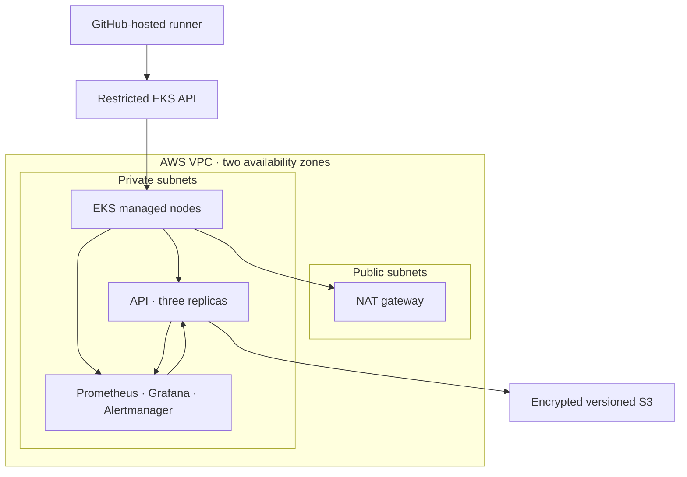
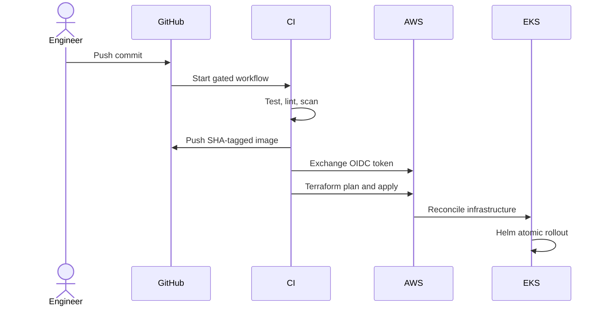
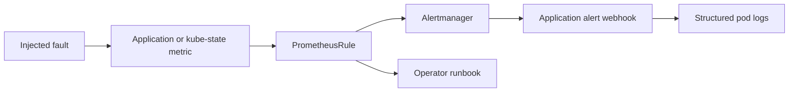

# Architecture

## Infrastructure topology

The S3 bucket represents durable application storage. The sample API does not
receive AWS credentials and therefore does not access it directly. In a real
workload, add an EKS Pod Identity or IRSA role with only the required object
operations.

## Delivery flow

The Helm release is atomic: if Kubernetes does not report healthy resources
before the timeout, Helm rolls the release back and Terraform reports failure.
The image tag is the immutable Git commit SHA.

## Failure-detection flow

The in-cluster webhook is intentionally self-contained for demonstration. A
real environment should route Alertmanager to PagerDuty, Slack, Datadog, or a
managed incident platform and place the receiver secret in an external secrets
store.

## Security boundaries

- Worker nodes and workloads run in private subnets.
- Public access to the Kubernetes API is restricted to explicit CIDRs.
- GitHub assumes an AWS role using repository and branch-scoped OIDC claims.
- The EBS CSI controller assumes its storage role through EKS Pod Identity.
- Pods run as non-root with a read-only root filesystem, no Linux capabilities,
  no privilege escalation, RuntimeDefault seccomp, and no service-account token.
- S3 data and Terraform state are versioned, encrypted, and blocked from public
  access.
- VPC flow logs and EKS control-plane logs support investigation.

---

**Paul Foseh** 
Senior DevOps Engineer
